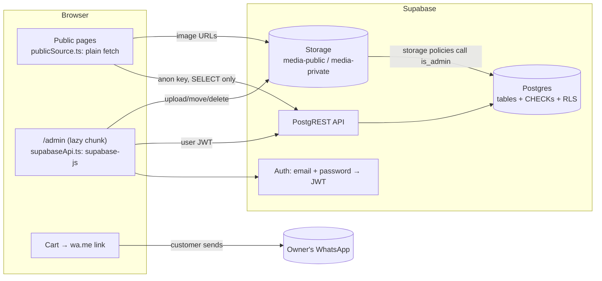
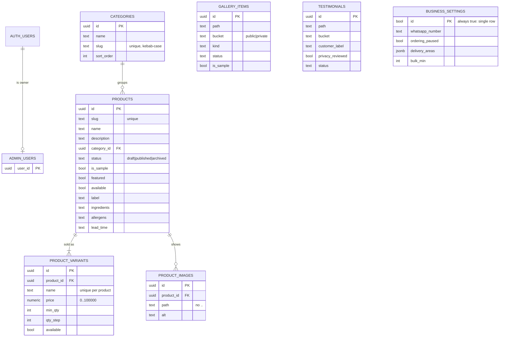
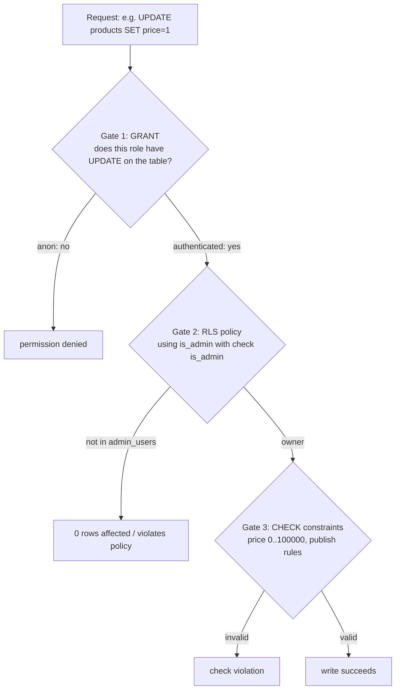
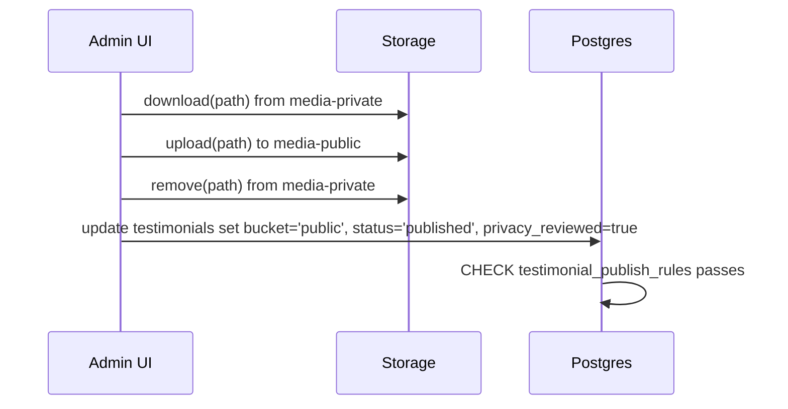

# The Brownie Press: backend guide

This guide covers **only the backend**: the database, its security rules, file storage, admin login, and how the
website talks to them. It is written for someone who knows **HTML, CSS, JavaScript and Python** and has never used
SQL databases, Supabase or Row Level Security. The frontend (React pages and styling) is out of scope here; the
`docs/` folder covers it.

---

## Table of contents

1. [The backend in one minute](#1-the-backend-in-one-minute)
2. [Concepts explained from zero](#2-concepts-explained-from-zero)
3. [Architecture](#3-architecture)
4. [The database schema](#4-the-database-schema)
5. [Security: grants, RLS and is_admin()](#5-security-grants-rls-and-is_admin)
6. [File storage](#6-file-storage)
7. [How the website reads and writes data](#7-how-the-website-reads-and-writes-data)
8. [Checkout without a server](#8-checkout-without-a-server)
9. [Testing the backend](#9-testing-the-backend)
10. [Setup and deployment](#10-setup-and-deployment)
11. [Decisions and why](#11-decisions-and-why)
12. [Honest weaknesses and fixes](#12-honest-weaknesses-and-fixes)
13. [Build a backend like this from scratch](#13-build-a-backend-like-this-from-scratch)
14. [Change requests you might get](#14-change-requests-you-might-get)
15. [Interview and recruiter questions](#15-interview-and-recruiter-questions)
16. [Glossary](#16-glossary)
17. [Self-check exercises](#17-self-check-exercises)

---

## 1. The backend in one minute

A home bakery in Mangalore needs a menu website that the owner can update from a phone. Customers browse, build a cart and
send the order on WhatsApp. The owner logs into `/admin` to edit products, prices, photos, gallery, customer feedback and settings.

**There is no custom server.** The backend is **Supabase**, a hosted service that gives you:

- a **PostgreSQL** database,
- an automatic **REST API** over that database (PostgREST),
- **Auth** (email + password login),
- **Storage** (file buckets for images).

All security lives **inside the database** as Row Level Security policies, so even if someone bypasses the website and calls the API
directly, they can only see published items and cannot change anything.

**Elevator pitch:**

> "The backend is Supabase with security enforced in Postgres. Public visitors use the anon key and RLS only lets them read
> published rows. Writes are allowed only when a `security definer` function `is_admin()` finds the user in a locked
> `admin_users` table. CHECK constraints protect business rules, like sample products never going live and customer screenshots
> needing a privacy review before publishing. I test the policies by running the real migrations on an in-process Postgres
> and switching roles."

---

## 2. Concepts explained from zero

### 2.1 SQL and PostgreSQL

A **relational database** stores data in **tables** (like spreadsheets): columns have types, each row is a record.
**SQL** is the language to talk to it. **PostgreSQL** ("Postgres") is a powerful, free relational database.

```sql
create table products (id uuid primary key, name text not null, price numeric(10,2));
insert into products (id, name, price) values (gen_random_uuid(), 'Fudge Brownie', 60);
select name, price from products where price < 100 order by name;
update products set price = 65 where name = 'Fudge Brownie';
delete from products where name = 'Fudge Brownie';
```

Python comparison: a table is like a list of dicts with a fixed set of keys and types; `select ... where` is a list comprehension with a filter.

Key terms:

- **Primary key:** unique id for each row (`uuid` here: a random 128-bit id like `3f2c...`).
- **Foreign key:** a column pointing to another table's primary key (`product_id references products(id)`).
- **`on delete cascade`:** delete a product → its variants and images are deleted too. **`on delete set null`:** delete a category → products keep existing with no category.
- **Constraint:** a rule the database enforces on every write (`not null`, `unique`, `check (...)`).
- **Index:** a lookup structure that makes searches fast, like a book's index.
- **Trigger:** a function that runs automatically on an event (here: set `updated_at` before every update).
- **Migration:** a SQL file that changes the schema. Files are numbered (`0001`, `0002`) and run in order, so every environment ends up identical.

### 2.2 Supabase

A hosted "backend in a box" built on Postgres. You create a project and get a URL like `https://xyz.supabase.co` and two keys:

- **anon key:** public. Safe to put in the browser. It only grants the `anon` role, which RLS restricts.
- **service_role key:** bypasses all security. **Must never reach the browser.** This project never uses it in the client.

### 2.3 PostgREST

Supabase automatically turns each table into a REST endpoint:

```
GET https://xyz.supabase.co/rest/v1/products?select=*,product_variants(*)&status=eq.published&order=sort_order
headers: apikey: <anon key>, Authorization: Bearer <anon key or user JWT>
```

`select=*,product_variants(*)` even follows foreign keys and nests related rows (an embedded join). `status=eq.published` is a filter.

### 2.4 Roles and grants

Postgres has **roles** (users). Supabase uses three that matter:

- `anon`: a visitor with no login.
- `authenticated`: anyone logged in.
- `postgres` / `service_role`: admin, bypasses RLS.

`grant select on products to anon` means "the anon role may run SELECT on this table at all". Grants are the first gate.

### 2.5 Row Level Security (RLS)

Grants are per table. **RLS is per row.** When enabled, every query is silently filtered by **policies**:

```sql
create policy "public read published products" on products
  for select to anon, authenticated using (status = 'published');
```

Now `select * from products` as anon returns **only published rows**, even if the request asks for everything.
`using (...)` filters what you can see or change; `with check (...)` validates the new row on insert/update.

If RLS is enabled and **no policy** matches, the answer is "nothing". That is the safe default.

### 2.6 JWT and `auth.uid()`

When the owner logs in through Supabase Auth, they get a **JWT** (signed token) containing their user id. Every request sends it.
Inside SQL, `auth.uid()` returns that id. Policies use it to know who is asking.

### 2.7 `security definer` functions

Normally a function runs with the caller's permissions. A **security definer** function runs with the **creator's** permissions.
`is_admin()` needs to read `admin_users`, which nobody can read through the API. Running it as the definer lets it check the table
while the table itself stays locked. `set search_path = public` stops a known attack where a user creates a fake table with the same name in another schema.

### 2.8 Object storage and buckets

Files (images) are not stored in tables. They go into **buckets** (folders in cloud storage). A table row stores only the file **path**.
A **public bucket** serves files to anyone by URL. A **private bucket** needs a **signed URL**: a temporary link with a secret that expires.

---

## 3. Architecture



**Three data modes** (`src/config/env.ts`):

| Mode | When | Backend |
|------|------|---------|
| `supabase` | URL + anon key set | Real Supabase |
| `demo` | `VITE_DATA_MODE=demo` or `vite dev` without keys | `localStorage` fake (no real security) |
| `unconfigured` | Production build with no keys | Public site shows a safe fallback; admin disabled |

The admin code talks to an **interface** (`AdminApi` in `api.ts`) with two implementations (`supabaseApi.ts`, `demoApi.ts`).
The pages never know which one they use. That is the **strategy pattern** / programming to an interface.

---

## 4. The database schema



### Interesting rules enforced by CHECK constraints

| Constraint | Business meaning |
|------------|------------------|
| `sample_never_published` | Placeholder products created from seed data can never go live until the owner confirms them |
| `gallery_published_is_public` | A published gallery image must be in the public bucket |
| `testimonial_publish_rules` | A customer screenshot can be published only from the public bucket **and** after `privacy_reviewed` is ticked |
| `slug ~ '^[a-z0-9]+(-[a-z0-9]+)*$'` | URL-safe slugs like `fudge-brownie` |
| `path !~ '\.\.'` | No `..` in file paths (path traversal) |
| `whatsapp_number ~ '^\+?[0-9 ()-]{8,20}$'` | Plausible phone format |
| `id boolean primary key default true check (id)` | Clever trick: the only allowed id is `true`, so the table can hold **exactly one row** |
| `jsonb_typeof(delivery_areas) = 'array'` | JSON column must be a list |

**Why in the database and not just in the form?** Because the API can be called directly. The database is the last line of defence; the UI checks are only for friendliness.

### Indexes and triggers

Indexes match the common queries: `(status, sort_order)` for "published, in display order", plus foreign keys. A shared trigger function `set_updated_at()` stamps `updated_at` on every update.

### Money

The database stores rupees as `numeric(10,2)` (exact decimal, never floating point). The client converts to **integer paise** (`toMinor`) for all arithmetic,
because in JavaScript `0.1 + 0.2 = 0.30000000000000004`. Integers do not have that problem.

---

## 5. Security: grants, RLS and is_admin()

Think of three gates, all inside Postgres:



### Gate 1: grants (least privilege)

```sql
revoke all on all tables in schema public from anon, authenticated;     -- start from zero
grant select on <content tables> to anon, authenticated;                 -- everyone may try to read
grant insert, update, delete on <content tables> to authenticated;       -- only logged-in users may try to write
grant insert, update on business_settings to authenticated;             -- settings can never be deleted
```

`anon` has **no write grants at all**.

### Gate 2: RLS policies

- **Public read:** products, gallery, testimonials only where `status = 'published'`. Variants and images only if their **parent product** is published (an `exists (...)` subquery). Categories and settings are fully public (no secrets in them).
- **Owner all:** `for all to authenticated using (is_admin()) with check (is_admin())`.

Policies for the same action are combined with **OR**: the owner matches "owner all" and sees drafts too; a visitor matches only "public read".

### `admin_users` and `is_admin()`

```sql
create table admin_users (user_id uuid primary key references auth.users (id) on delete cascade);
alter table admin_users enable row level security;
-- Deliberately NO policies
```

RLS on with **no policies** = nobody can read or write it through the API, not even the owner. The owner is added once by hand in the Supabase SQL editor.
`is_admin()` is `security definer`, so it can look inside. **Signing up a new account does not make you an admin**, because only someone with database access can insert into `admin_users`.

The admin UI also calls `rpc('is_admin')` right after login and signs out non-admins (`ensureAdmin`). That is for a friendly message; the real protection is still RLS.

### Client-side safety

- `.env.example` warns: never put `service_role` in a `VITE_*` variable (anything starting with `VITE_` is bundled into public JS).
- The admin session is stored in `sessionStorage` (cleared when the tab closes).
- `public/_headers` sets a strict **Content Security Policy**: scripts only from the site itself, network calls only to `*.supabase.co`, no framing.

---

## 6. File storage

Two buckets, created by `0002_storage.sql`:

| Bucket | Public? | Holds | Limits |
|--------|---------|-------|--------|
| `media-public` | yes (by URL) | Product photos, published gallery and feedback images | 5 MB, jpeg/png/webp |
| `media-private` | no | Draft gallery images, unreviewed customer screenshots | 5 MB, jpeg/png/webp |

Storage policies on `storage.objects`: only `is_admin()` can list, upload, update or delete. Public files are served by URL without a policy; the private bucket has no anon policy, so it is unreachable.

**Publishing moves the file:**



**Before upload** (`src/admin/image.ts`):

1. Reject files over 15 MB.
2. **Sniff the first bytes** to confirm it is really JPEG/PNG/WebP (a renamed `.exe` fails). File names and reported types can lie; magic bytes do not.
3. Resize to a maximum dimension on a `<canvas>` and re-encode to WebP. This also **strips EXIF metadata such as GPS location** from customers' phone photos.
4. Final size must be under 5 MB (the bucket also enforces this on the server).

Uploaded files get random UUID names, so they cannot collide or be guessed. Private previews use **signed URLs** that expire after one hour.

---

## 7. How the website reads and writes data

### Public reads (`src/data/publicSource.ts`)

Five requests in parallel with `Promise.all`, using plain `fetch` (not the Supabase library) so visitors download about 55 kB less JavaScript:

```
business_settings?select=*&limit=1
categories?select=*&order=sort_order
products?select=*,product_variants(*),product_images(*)&status=eq.published&order=sort_order
gallery_items?select=*&status=eq.published&order=sort_order
testimonials?select=*&status=eq.published&order=sort_order
```

The `status=eq.published` filter is a performance hint; RLS would hide drafts anyway. `mapping.ts` converts rows into the app's types.
`DataContext.tsx` holds the result in React state with `loading / ready / error` and a `reload()`.

### Admin writes (`src/admin/supabaseApi.ts`)

| Method | What it does |
|--------|--------------|
| `signIn`, `getUser`, `signOut` | Supabase Auth + `ensureAdmin` |
| `loadAll` | Everything including drafts (RLS allows it for the owner) |
| `saveProduct` | Upsert the product; delete variants/images that were removed in the form; upsert the rest |
| `setProductStatus`, `reorder` | Small updates |
| `saveCategory`, `deleteCategory`, `saveSettings` | Upserts and deletes |
| `upload`, `moveMedia`, `deleteMedia`, `previewUrl` | Storage |
| `saveGallery`, `saveTestimonial` and deletes | Rows + their files |
| `removeSamples` | Delete all `is_sample` products and gallery rows once real content exists |

**Upsert** = "insert, or update if the id already exists". The client generates UUIDs (`crypto.randomUUID()`), so the same call works for new and existing rows.

`fail(error, what)` turns Supabase errors into readable messages for the owner.

---

## 8. Checkout without a server

There is no orders table. `src/lib/whatsapp.ts` builds a text message (items, quantities, totals, name, pickup or delivery, notes) and a link:

```
https://wa.me/919071983473?text=<URL-encoded message>
```

The customer's WhatsApp opens with the message ready; the customer presses send. `normalizeWhatsAppNumber` handles `+91`, `0091` and bare 10-digit numbers.
`clean()` removes control characters. Messages over 4000 encoded characters are flagged because some phones truncate long links.

**Why:** a small home bakery confirms every order personally anyway. No payment, no order database, nothing sensitive to protect, no server to pay for.
`cart.ts` **revalidates** the cart against the live catalogue (`resolveCart`), so a stale price saved in the browser is never trusted.

---

## 9. Testing the backend

`supabase/tests/rls.test.ts` is the most impressive part to show in an interview.

1. Start **PGlite**: real Postgres compiled to WebAssembly, running inside the Node test process. No Docker, no cloud.
2. Load `stubs.sql`: fake versions of what Supabase provides (`anon` and `authenticated` roles, `auth.users`, `auth.uid()` reading a setting, `storage` tables).
3. Run the **real** migrations and seed.
4. Insert an owner and a stranger.
5. For each test, switch role with `set role anon` / `authenticated` and set the JWT subject, then run queries and assert.

It proves: anon sees only published content; anon cannot read the private bucket; anon cannot write; a logged-in stranger cannot write; the owner can; CHECK constraints block publishing samples and unreviewed screenshots.

```bash
npm run test:rls
```

Unit tests in `src/lib/lib.test.ts` cover money, quantity steps, cart revalidation and WhatsApp message building.

---

## 10. Setup and deployment

(Full steps: `docs/DEPLOYMENT.md` and `docs/ADMIN_GUIDE.md`.)

1. Create a Supabase project.
2. SQL editor: run `0001_init.sql`, `0002_storage.sql`, then `seed.sql`.
3. Auth → create the owner user (email + password). Copy its id.
4. SQL editor: `insert into public.admin_users (user_id) values ('<owner uuid>');`
5. Copy the project URL and **anon** key into `.env.local` / the hosting provider's environment variables.
6. `npm run build` and deploy `dist/` to Netlify, Vercel, Cloudflare Pages or GitHub Pages.
7. In `/admin`, replace samples with real products, confirm the menu, publish.

---

## 11. Decisions and why

| Decision | Why | Trade-off |
|----------|-----|-----------|
| Supabase, no custom server | Free tier, managed Postgres, auth and storage; nothing to patch | Tied to one vendor; logic in SQL |
| Security in RLS | Holds even if the API is called directly | SQL policies are harder to read than code |
| Locked `admin_users` + `is_admin()` | Sign-up cannot grant admin | Owner added by hand once |
| CHECK constraints for business rules | Impossible states cannot exist | Changing a rule needs a migration |
| WhatsApp checkout | Matches how the bakery works; no payments or PII stored | No order history in the system |
| Plain fetch for public reads | Smaller bundle, faster site | Two ways of calling the API |
| Two buckets + move on publish | Private material is never reachable by URL | Move is three steps, not atomic |
| Client-side image processing | Saves bandwidth; strips GPS | Depends on browser canvas support |
| PGlite RLS tests | Fast, real Postgres, no Docker | Stubs must mimic Supabase correctly |
| Demo mode | Build and test without any backend | Must never be used in production |

---

## 12. Honest weaknesses and fixes

1. **`saveProduct` is several separate requests.** If the network drops halfway, variants could be partly saved. *Fix:* a Postgres function `save_product(jsonb)` called via `rpc`, which runs in one transaction.
2. **`moveMedia` is not atomic** (download, upload, remove). A failure can leave a copy in both buckets. *Fix:* use `storage.move` or a cleanup job.
3. **`reorder` sends one update per row.** Fine for 20 items. *Fix:* one `rpc('reorder', ids)` that updates in a single statement.
4. **No order history.** By design. *Fix if needed:* an `order_requests` table with insert-only anon policy and rate limiting.
5. **One owner role.** No staff with limited rights. *Fix:* add a `role` column to `admin_users` and finer policies.
6. **Public settings include contact email.** Intended, but worth stating.

---

## 13. Build a backend like this from scratch

1. **Learn SQL basics** with any free Postgres (Supabase SQL editor works): create, insert, select, update, delete, joins.
2. **One table:** `products(id, name, price, status)`. Insert rows; query from the browser with `fetch` to `/rest/v1/products` and the anon key.
3. **Turn on RLS** and see the query return nothing. Add a "public read published" policy. See drafts disappear.
4. **Auth:** create a user; log in with `supabase-js`; try to insert and watch it fail.
5. **admin_users + is_admin():** add the owner policy; now inserts work for the owner only.
6. **Variants and images** tables with foreign keys and cascade.
7. **CHECK constraints** for each business rule.
8. **Storage:** create a bucket, upload from the browser, store the path in a row.
9. **Migrations:** move all SQL into numbered files so you can rebuild the database from zero.
10. **Tests:** PGlite + role switching.

Time: 2 to 3 weekends.

---

## 14. Change requests you might get

### "Hide a product without deleting it."

Already possible: set `status = 'archived'`. RLS only shows `published`.

### "Add a discount percentage to variants."

New migration `0003_discount.sql`:

```sql
alter table public.product_variants
  add column discount_pct integer not null default 0 check (discount_pct between 0 and 90);
```

Add it to `types.ts`, `mapping.ts`, the admin form, and the cart maths (in paise). Add an RLS test that anon still cannot update it.

### "Store order requests."

```sql
create table public.order_requests (
  id uuid primary key default gen_random_uuid(),
  payload jsonb not null check (pg_column_size(payload) < 8000),
  created_at timestamptz not null default now()
);
alter table public.order_requests enable row level security;
grant insert on public.order_requests to anon;
create policy "anyone can submit" on public.order_requests for insert to anon with check (true);
create policy "owner reads" on public.order_requests for select to authenticated using (public.is_admin());
```

Then discuss spam: add a captcha or an Edge Function with rate limiting.

### "Add a second admin."

Create the user in Auth, then `insert into public.admin_users (user_id) values ('<uuid>');`. No code change.

### "Make the RLS test check the new table."

Copy a block in `rls.test.ts`: `as('anon', null, () => db.query('select * from public.order_requests'))` → expect 0 rows; insert as anon → succeeds.

---

## 15. Interview and recruiter questions

**Q: Where is your backend?** Supabase: Postgres with PostgREST, Auth and Storage. No custom server because orders go through WhatsApp; the only data is the catalogue and media.

**Q: What stops a visitor from editing prices with the API?** Three layers in Postgres: anon has no write grants; RLS write policies require `is_admin()`; CHECK constraints validate values. The anon key is public by design and grants nothing beyond that.

**Q: What is RLS?** Per-row security policies that Postgres applies to every query. A visitor's `select *` is automatically filtered to published rows.

**Q: How is the admin decided?** A locked `admin_users` table (RLS on, no policies) checked by a `security definer` function. Signing up cannot make you an admin.

**Q: Why `set search_path` on that function?** To stop search-path hijacking, where a caller makes an object with the same name in another schema to trick a privileged function.

**Q: `using` vs `with check`?** `using` filters rows you can see/affect; `with check` validates the row being written.

**Q: How do you keep customer screenshots private?** They upload to a private bucket. The DB refuses to publish one unless it is in the public bucket and `privacy_reviewed` is true. Publishing moves the file. Images are re-encoded, which strips EXIF GPS data.

**Q: How did you test security?** Real migrations in PGlite (Postgres in WebAssembly), switching between anon, a stranger and the owner, asserting what each can read and write.

**Q: Why integer paise?** Floating-point errors. The DB uses exact `numeric`, and the client does arithmetic in integers.

**Q: What would you improve?** Make multi-step saves transactional with a Postgres function, make media moves atomic, and add order history if the business needs it.

---

## 16. Glossary

| Word | Meaning |
|------|---------|
| anon key | Public Supabase key for unauthenticated requests |
| Bucket | A container for files in object storage |
| CHECK constraint | A rule the database enforces on every write |
| Embedded resource | PostgREST nesting related rows with `select=*,child(*)` |
| Foreign key | Column referencing another table's row |
| Grant | Table-level permission for a role |
| Migration | Versioned SQL file that changes the schema |
| PGlite | Postgres compiled to WebAssembly, runs in Node |
| PostgREST | Auto-generated REST API over Postgres |
| RLS | Row Level Security: per-row access policies |
| RPC | Calling a database function over the API |
| security definer | Function that runs with its creator's rights |
| service_role key | Supabase key that bypasses RLS; server-only |
| Signed URL | Temporary link to a private file |
| Upsert | Insert or update by id |

---

## 17. Self-check exercises

1. Explain the three gates for `UPDATE product_variants SET price = 1` as anon, as a stranger, and as the owner.
2. Why does `admin_users` have RLS enabled but no policies?
3. Write a policy so anon can read only `available` variants.
4. Write migration `0003` adding `discount_pct` and an RLS test for it.
5. Run `npm run test:rls` and read each test aloud in plain English.

---

## Talking about AI-assisted work

> "I built this with AI assistance. The part I made sure I fully understand is the security model: grants, RLS policies,
> the locked admin table and the CHECK constraints, and I can show the tests that prove each rule."

- Say "AI-assisted" honestly, then prove ownership: open `0001_init.sql` and explain each policy.
- Practise the change requests in section 14 by hand in a free Supabase project.
